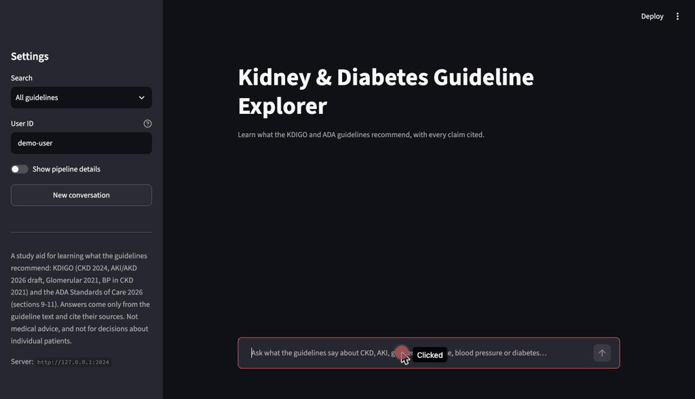

# kdigo-guideline-rag

A study aid for learning what kidney and diabetes guidelines recommend: treatment patterns, disease definitions and how strong the evidence is, answered from the guideline text and cited to the exact recommendation. Built with LangGraph, Claude, Voyage embeddings and Chroma.

It is a learning and portfolio project, not a clinical tool: it isn't meant for decisions about individual patients.



**Knowledge base:** four KDIGO guidelines (CKD 2024, AKI/AKD 2026 public review draft, Glomerular Diseases 2021, Blood Pressure in CKD 2021) and the ADA Standards of Care in Diabetes 2026, Sections 9–11 plus its grading methodology.

**What it does well**
- Cites a guideline, chapter and recommendation number for every claim, and keeps the guideline's own strength wording ("suggest" ≠ "recommend").
- Declines out-of-scope questions with a fixed response instead of answering from model knowledge.
- Handles follow-ups ("And ACE inhibitors or ARBs?") by rewriting them into standalone questions.
- Adds new guidelines through a one-time onboarding step that chooses how to parse each document ([below](#adding-a-new-guideline)).

**Measured** on a 73-question eval set, with gold evidence verified against the index:

| | Result |
|---|---|
| Retrieval, KDIGO questions (recall@5) | 0.88 |
| Retrieval, ADA questions (recall@5) | 0.90 |
| Retrieval, ADA-vs-KDIGO comparisons (recall@5) | 0.33 — [known gap](#known-limitations) |
| Answers free of material errors (Opus 5.5 judge) | 0.80 dev, 0.89 held-out |
| Out-of-scope questions correctly declined | 1.00 |

All figures are on the current index (KDIGO + ADA) and prompt. Setup, breakdowns and known gaps: [EVALUATION.md](EVALUATION.md).

## Quickstart

Requires [pixi](https://pixi.sh). Put the source PDFs in `data/` (gitignored):

- KDIGO, free from [kdigo.org](https://kdigo.org): `KDIGO-2024-CKD-Guideline.pdf`, `KDIGO-2026-AKI-AKD-Guideline-Public-Review-Draft-March-2026.pdf`, `KDIGO-2021-Glomerular-Diseases-Guideline_English_LN-2024-Update.pdf`, `KDIGO-2021-Blood-Pressure-in-CKD-Guideline.pdf`
- ADA, from [diabetesjournals.org/care](https://diabetesjournals.org/care): `ADA-2026-SOC-Introduction-Methodology.pdf`, `ADA-2026-SOC-09-Pharmacologic-Glycemic.pdf`, `ADA-2026-SOC-10-Cardiovascular.pdf`, `ADA-2026-SOC-11-CKD.pdf`

```bash
pixi install
cp .env.example .env        # ANTHROPIC_API_KEY, VOYAGE_API_KEY
pixi run ingest             # parse, chunk and embed into Chroma
pixi run dev                # LangGraph API server + Studio
pixi run ui                 # Streamlit chat app (alongside `dev`)
pixi run test
```

Evaluation:

```bash
pixi run eval-retrieval     # tier 1: retrieval hit@5 / recall@5 / MRR, no LLM
pixi run eval               # tier 2: full graph; saves the run
pixi run eval-judge         # tier 3: Opus 5.5 judges the saved answers
pixi run eval-conversations # multi-turn context handling
```

## Architecture

```
question ─▶ prepare ─▶ update_memory ─▶ condense ─▶ retrieve ─▶ grade ─┬─▶ generate ─▶ answer
                                                       ▲              │ nothing relevant
                                                       └── rewrite ◀──┘ (once)
```

- **condense** turns a follow-up into a standalone question using the conversation.
- **grade** has Claude judge each retrieved passage for relevance. If nothing survives, the question is rewritten once. If nothing survives again, a fixed "not covered" response is returned without calling the model.
- **generate** answers only from the graded passages, plus each organization's grading table.
- **update_memory** keeps facts about the *user* (background, recurring topics) to set the level of explanation.

The Streamlit app talks to the LangGraph server over HTTP. It shows each answer's sources, what its evidence grades mean, and how a follow-up was interpreted.

## Deploy

Local only for now (`pixi run dev` + `pixi run ui`). A `docker compose` deployment is planned. The UI already reads `LANGGRAPH_API_URL`, so it can point at a remote server.

## Example queries

- "How is CKD staged by eGFR and albuminuria?"
- "Which people with CKD should be treated with a statin?"
- "How is AKI defined, and what is AKD?"
- "How do the ADA and KDIGO blood pressure targets differ for people with diabetes and CKD?"

## Design notes

- **Docling for layout, the PDF text layer for recommendations.** Docling keeps figures and tables out of paragraph text and preserves headings (Unstructured fragmented sentences). Where Docling's reading order cuts a boxed recommendation, the PyMuPDF text layer supplies it. The text layer is used only when its copy appears verbatim in the PDF.
- **Recommendation-anchored chunks, not fixed-size ones.** Each recommendation is its own chunk, with its number and grade, so the answer can cite it exactly.
- **Text stays verbatim.** Figure text is indexed as Docling extracted it, in layout order, not rewritten by a model. Ligature and missing-space artifacts are repaired with a word-frequency dictionary, and only on strong evidence. Mis-decoded font glyphs (`$`→`≥`, `£`→`≤`) are fixed per publisher.
- **"Not covered" is enforced in code, not in the prompt.** When asked to decline in the prompt, the model still gave ESA and tolvaptan doses from its own knowledge. Now, if no passage survives grading, the model is never called.
- **Grades are explained only with their own organization's table.** KDIGO's 1B and ADA's B mean different things.
- **Follow-ups are condensed, but each answer sees only its own passages,** so every claim stays tied to a citation from that turn.
- **Three-tier eval with corpus-verified gold labels.** Gold evidence is an anchor in the source text (a recommendation number, caption or phrase), so labels survive re-chunking. Retrieval is scored deterministically and used for every index decision. Answers are judged by Opus 5.5, a different model from the Sonnet 5 generator. The judge is checked against planted errors: it caught 8/8 fabricated recommendations and 6/7 altered numbers ([details](EVALUATION.md#results)). A held-out split is used only to confirm decisions.
- **Models.** Sonnet 5 grades and generates: it is about 2.5× cheaper than Opus and sufficient for answering from provided passages. Voyage embeddings are Anthropic's recommended partner and fall within the free tier at this corpus size. Chroma runs embedded, which is enough at this scale.
- **The AKI source is the 2026 public review draft**, for current AKI/AKD scope. Its recommendations may change before final publication.

## Known limitations

- **Cross-organization comparisons retrieve poorly** (recall@5 0.33). A single top-5 search returns trial discussion, often from one guideline. Planned fixes, to be measured on these questions: one search per organization named, or query decomposition. Adding ADA also slightly crowded KDIGO retrieval (recall@5 0.90 → 0.88).
- **Numeric staging questions** ("which stage is an eGFR of 38?") depend on retrieving the category table. Embeddings don't reason over numeric ranges.
- **Flowchart figures** come through in layout order, and the generator can assign a treatment to the wrong branch. 99 figures with no extractable text aren't indexed; a vision fallback is deferred.
- **Superseded content is indexed:** the Glomerular PDF contains both the outdated 2021 lupus chapter and its 2024 replacement.
- **ADA Rec 9.12 is incomplete.** A full-page figure interrupts it.
- **Answers vary run to run.** About 1 in 4 questions differ between identical runs, so decisions are based on aggregate results.
- **Drug names vs class names.** "finerenone" doesn't retrieve the finerenone recommendations, which say "nonsteroidal MRA"; the class name does. No hybrid (BM25 + vector) search yet.

## Adding a new guideline

Each guideline has a **profile** (`src/kdigo_guideline_rag/ingest/profiles/*.json`). It records the recommendation and grade patterns, heading rules, page-furniture noise, glyph fixes, and which extractor supplies recommendation text. A profile is decided once, when the document is added:

```bash
pixi run onboard data/NEW.pdf --name "Guideline name" --slug new-guideline
```

1. **Selector** (no LLM) tries every known profile with both extractors. It scores each on a parse-quality **scorecard**: numbering gaps, recommendations missing compared with the text layer, cut-off or non-verbatim text, leftover artifacts, and suspect glyphs.
2. **Agent** runs only if nothing passes. Claude Opus 5.5 inspects the document through tools and iterates on a profile against the same scorecard. It chooses settings only; text always comes verbatim from the extractors. A run costs about $0.10–0.70 per document.
3. **Review** the saved profile, which records the scorecard and the agent's rationale. Then run `pixi run ingest` and `pixi run eval-verify`, and add eval questions.

To test it, the four KDIGO guidelines were onboarded from a blank profile. The agent matched or beat the hand-built configuration on all four. It rediscovered every mis-decoded glyph and found two AKI practice points hidden behind typos in the source. The ADA sections, from a different publisher, onboarded with all 127 recommendations matching the text layer. Review still matters: the agent proposed deleting the "OUTDATED" banner on the superseded lupus chapter. It also put a figure-caption pattern into the page-noise list, which was later found to delete captions.

## References

- Miao J, Thongprayoon C, Suppadungsuk S, Garcia Valencia OA, Cheungpasitporn W. [Integrating Retrieval-Augmented Generation with Large Language Models in Nephrology: Advancing Practical Applications](https://pmc.ncbi.nlm.nih.gov/articles/PMC10972059/). Explores RAG + LLMs for nephrology using KDIGO guidelines as the reference base — related prior work motivating this project's approach.
